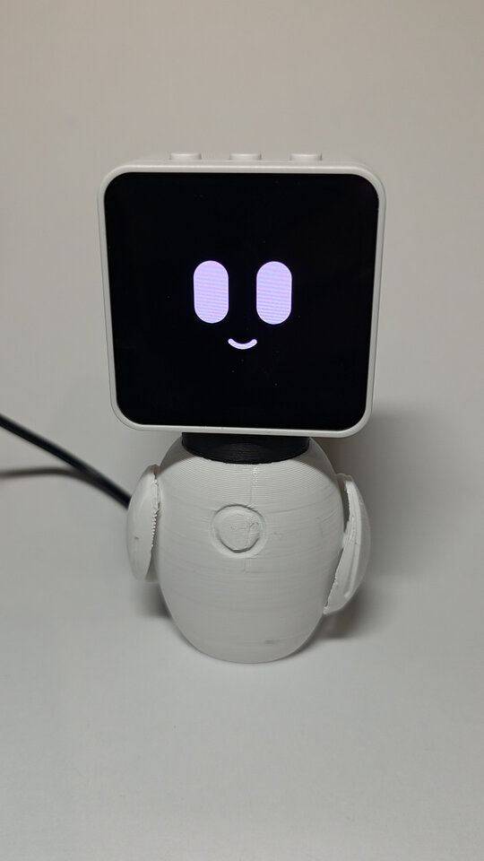

# Stavvy

<p align="center"></p>

Stavvy is a small voice assistant that sits on my desk and has a cute animated face. You
say "Stavrobot", ask it something, and it shows you what it heard, shows you the answer as
text, and then reads the answer out loud.

It runs on a [Waveshare ESP32-C6-Touch-AMOLED-2.16](https://www.waveshare.com/esp32-c6-touch-amoled-2.16.htm),
and it's the voice and face of [Stavrobot](https://github.com/skorokithakis/stavrobot).


## What it does

- It listens for the wake word "Stavrobot" on the device itself, and nothing leaves the
  device until it hears it.
- It streams your question to the server, shows the transcript and the reply on the
  screen, and plays the spoken reply.
- When it's idle, it shows a drawn face that breathes, blinks and sometimes looks around.
- It looks surprised when you pick it up and relieved when you put it down, for no
  practical reason at all.
- It dims the screen after 30 seconds of being idle.


## How it fits together

```
Stavvy  <-- ESPHome API -->  havpe-server  <-- webhook -->  Stavrobot
```

Stavvy doesn't do any of the thinking, it's basically a microphone, a speaker and a
screen, and it doesn't have any API keys. [havpe-server](https://github.com/skorokithakis/havpe-server)
runs the voice pipeline (speech-to-text and text-to-speech, both through ElevenLabs, plus
voice shortcuts), and Stavrobot is the assistant that actually answers.


## Buttons

| Button | Action |
| --- | --- |
| KEY | Mutes or unmutes the microphone, and the face changes so you can tell it's muted. |
| BOOT | Steps the screen brightness through 40, 60, 80 and 100%. Stavvy remembers the level. |
| PWR | A short press turns it on, a long press turns it off. |

If the screen ever goes black, touching it redraws it. This does happen occasionally, and
I haven't worked out why yet.


## Setup

1. Set up Stavrobot and havpe-server, and point havpe-server's webhook at Stavrobot.
2. Build and flash Stavvy with your Wi-Fi details (see below).
3. Start havpe-server with `--network host`. It finds Stavvy on the network by itself, so
   Stavvy doesn't need a fixed IP address. You only need to set `DEVICE_HOST` if mDNS
   doesn't reach havpe-server, for example if they're on different subnets.

A few things to keep in mind:

- Stavvy and havpe-server need to reach each other in both directions, because
  havpe-server connects to Stavvy on port 6053 and Stavvy downloads the spoken reply from
  havpe-server. If a VLAN blocks either direction, the replies will break.
- Stavvy pretends to be a Home Assistant Voice PE, because that's what havpe-server looks
  for. Keep only one such device on the network, otherwise havpe-server won't start.
- The connection isn't encrypted, so only use it on a network you trust.


## Build and flash

You need Docker, and that's it, you don't have to install anything else.

First, set your Wi-Fi network and password (they're under "Wi-Fi configuration"):

```sh
docker run --rm -it -v "$PWD":/project -w /project -u "$(id -u):$(id -g)" -e HOME=/tmp \
    espressif/idf:v5.5.3 idf.py menuconfig
```

Then connect the board over USB, and build and flash:

```sh
docker run --rm -it --device=/dev/ttyACM0 --group-add dialout -v "$PWD":/project -w /project \
    -u "$(id -u):$(id -g)" -e HOME=/tmp espressif/idf:v5.5.3 \
    idf.py -p /dev/ttyACM0 flash monitor
```

Your Wi-Fi details stay in `sdkconfig`, which git ignores, so you won't commit them by
accident.


## Body

`body/` has a 3D-printable robot body for the board to sit on, and `body/README.txt` has
the details.


## Credits

The sound that plays when Stavvy hears the wake word is the Home Assistant Voice PE's
`wake_word_triggered` sound by Clayton Charles Tapp
([cctaudio.com](https://www.cctaudio.com/)), used under the
[CC BY 4.0](https://creativecommons.org/licenses/by/4.0/) licence.


## Licence

AGPL-3.0, see `LICENSE`.
